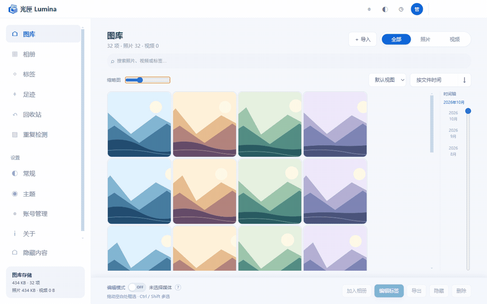
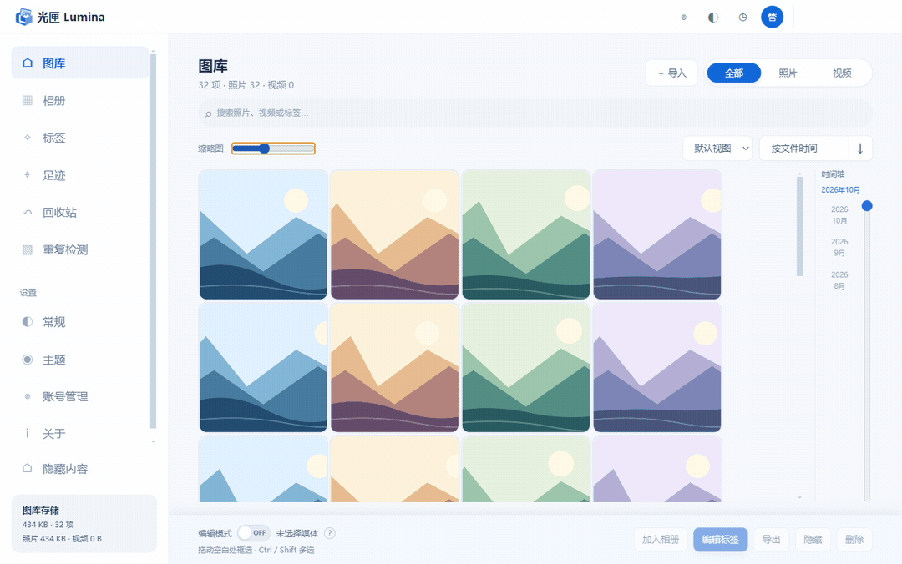

# Lumina

**Find, organize and use the photos, videos and reference images scattered across your folders.**

[简体中文](README.md) · [English](README.en.md) · [日本語](README.ja.md)


Lumina is a **local photo and video organizer for Windows**. Add your existing folders to browse everything in one place, combine search filters, add tags, build albums and compare duplicate or similar photos. No account is required, and everyday organizing works offline.

**Version 1.0.0 · Windows 10 / 11 x64 · Chinese, English and Japanese**

[Download the installer or ZIP](https://github.com/710765989/Lumina/releases/tag/v1.0.0) · [Detailed guide, in Chinese](docs/user-guide.md) · [Report an issue](https://github.com/710765989/Lumina/issues)

## What makes it useful?

**Keep your folders. Add another way to find things.** You do not have to move your collection into a special library. Lumina records file locations and creates viewing caches; originals stay in the folders you select. Browse several folders together, or jump to a particular month on the timeline.

**Put one image in several categories without copying it.** A beach photo can belong to “Travel,” “Landscape” and “Wallpapers.” Assign several tags or add it to several albums: they still refer to the same file. Tags support up to five levels and multiple parents, so a growing reference collection does not need a growing pile of copies.

**Let rules handle recurring organization.** Create a smart album that includes “Travel” and “Landscape.” Other photos appear there when they receive matching tags. Directory tags can also apply to a folder and its subfolders, including newly discovered files.

**Compare before cleaning up, then take your picks elsewhere.** Exact duplicates and visually similar photos have separate results. Compare side by side, choose what to keep and review file counts and sizes before deleting. Drag selected files into apps that accept file drops instead of locating them again in File Explorer.

## When would I use it?

| Your situation | A useful workflow |
| --- | --- |
| Photos are spread across years, devices and backup folders | Add the folders and browse them together by date |
| An image is both a portrait and a composition reference | Give it several tags while keeping one original |
| You repeatedly look for the same category | Create a smart album that collects matching tags |
| Exports, backups and similar shots are mixed together | Detect, compare and select files before deleting |
| You need a found image in another app | Drag it out, or reveal it in File Explorer |
| You prefer to keep a private collection on your computer | Build the index and caches locally, without a cloud account |

## See it in use

**Resize and switch views.** Choose the default grid, timeline, waterfall or list view. Adjust thumbnails with the slider or `Ctrl` + mouse wheel. Animations can be disabled in settings.



**Narrow a search one condition at a time.** Start with a tag, then add a filename or format condition. Exclude tags or find untagged files. Chinese supports pinyin, Japanese supports kana and romaji, and English matches names and aliases directly.



The recordings show the Chinese interface with an isolated example collection. The compressed GIFs are not a benchmark of the app's frame rate or performance on every device.

## Get started in five minutes

1. **Add a folder:** open General settings, find the directory section and select an existing photo or video folder.
2. **Choose the cache location:** confirm it before the first scan. An SSD with enough free space is an option.
3. **Browse:** try the timeline, search and right-click menu in Library.
4. **Organize a few files:** add tags, then create an ordinary or smart album.
5. **Check progress:** use the task button at the top right or task status in settings for large operations.

**Adding a folder mainly builds an index. Importing copies files to a destination you confirm.** Import supports file drops, paste and batches of folders, with a prompt for filename conflicts.

## Which download do I need?

Choose an asset on the [1.0.0 release page](https://github.com/710765989/Lumina/releases/tag/v1.0.0):

| File | Purpose | How to use it |
| --- | --- | --- |
| `Lumina-1.0.0-Setup-x64.exe` | Windows installer | Follow the wizard, then open the desktop or Start menu shortcut |
| `Lumina-1.0.0-win-x64.zip` | Run without installing | Extract the entire ZIP and run `Lumina.exe` |
| `Lumina-1.0.0-source.zip` | Read or build the code | Source files; not a runnable app |
| `SHA256SUMS.txt` | Verify downloads | Compare the file's SHA-256 hash |

You do not need Node.js, Python or a separate FFmpeg installation to use the app. Choose a language during installation or change it later in General settings. English and Japanese shortcuts are named **Lumina**; Chinese shortcuts are named **光匣 Lumina**.

Downloads are not code-signed, so Windows may show an unknown publisher warning. Check the source and use `Get-FileHash .\Lumina-1.0.0-Setup-x64.exe -Algorithm SHA256` in PowerShell to verify the file.

## A few things to know about your files

- **Originals, organization data and caches are different.** Originals stay in your media folders. Tags, albums and the index live in a local database. Thumbnails and compatibility previews are caches. Caches can be rebuilt; back up the organization database.
- **Local organization is not a backup.** Lumina does not automatically back up originals or delete duplicates when you add a folder.
- **Hidden does not mean encrypted.** In-app hiding and the optional Windows Hidden attribute control visibility, not password access.
- **You decide which similar photos to delete.** Removing an item from an ordinary album changes membership; deleting media starts a file operation. Permanent deletion cannot be undone.
- **An extension does not guarantee playback.** Some HEIF files, AVI videos or unusual codecs may be unsupported or need a slow compatibility preview. An external viewer or player may help. WebM is treated as video.

Check General → Cache settings for actual database and cache paths. The ZIP edition also uses the Windows user's application data directory. **Copying the program folder does not migrate all your organization data.** Close the app and back up originals and user data before upgrading. Uninstalling keeps the user database by default; external caches remain, while caches inside the installation folder may be removed with that folder. [More details, in Chinese](docs/user-guide.md)

Lumina focuses on local browsing and organization. It does not provide professional photo editing, cloud backup, team collaboration, encrypted vaults, face recognition or image-content search. The Japanese dictionary supplies readings, **not translations**. Performance depends on storage, codecs, collection size and playback settings. Continuing compatibility and large-collection testing is documented in the [acceptance records, in Chinese](docs/m2-acceptance.md).

## Handy controls

| Action | Result |
| --- | --- |
| Click / double-click | Select / open media |
| `Ctrl`, `Shift` + click or arrow keys | Toggle or extend selection |
| Drag across empty space | Draw a selection box |
| `Ctrl` + mouse wheel | Resize thumbnails |
| `F5` / mouse side buttons | Refresh / navigate back and forward |
| `Enter` / `Esc` in the viewer | Toggle fullscreen / close the current viewing layer |

## Read the code or build it yourself

Use Windows x64, Node.js 22.13 or newer, and pnpm 11.25.0. Python and Visual Studio C++ Build Tools are also needed if native dependencies lack compatible prebuilt binaries.

```powershell
corepack enable
corepack prepare pnpm@11.25.0 --activate
pnpm install --frozen-lockfile
pnpm typecheck
pnpm test
pnpm --filter @lumina/desktop dev
```

Build a ZIP with `pnpm --filter @lumina/desktop package:zip`, or use `package:installer` for the installer. Output goes to `apps/desktop/release/`. The first build downloads dependencies; everyday app use can be offline. The repository and source ZIP exclude personal media, databases, caches, logs and credentials.

A project-level source license has not been selected. Being able to view the code does not by itself grant an open-source license. Third-party components retain their licenses and attribution; see [THIRD_PARTY_NOTICES.md](THIRD_PARTY_NOTICES.md).

[Architecture](docs/architecture.md) · [Development status](docs/development-status.md) · [Roadmap](docs/光匣Lumina-版本开发计划与待办清单.md) — these detailed documents are currently in Chinese.

When reporting a problem, include the app version, Windows version and steps to reproduce it. Remove private paths, filenames and location data from logs or screenshots. Do not upload your real library or database.
